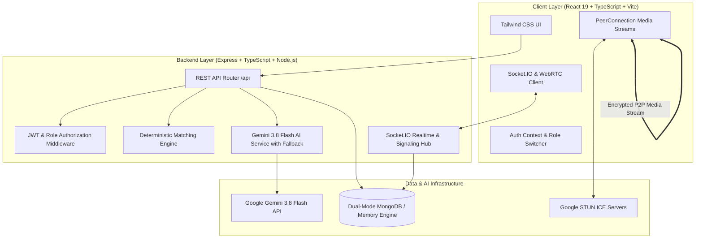

# Mentor Connect AI

> **"Find the mentor who has already walked your path."**
> 
> *Verified mentors. Personalized guidance. Clearer careers.*

**Team Name:** Parallax  
**Event:** Rethink 26 Hackathon  
**Institution:** Maharaja Agrasen College, University of Delhi  
**Team Members:** Himesh, Sakshi Singh, Arush Pratap, Raj Kurele  

---

## 1. Executive Summary & Problem

Students in India frequently make life-defining career, stream, examination, and skill decisions without access to trustworthy, practical mentorship. Generic internet advice is:
- **Scattered & Unstructured:** Fragmented across YouTube, Reddit, and forums.
- **Unreliable & Commercialized:** Influencer claims without institutional verification.
- **Difficult to Personalize:** Lacks context regarding student tier, branch, and semester timeline.

**Mentor Connect AI** bridges this gap by connecting students directly with verified college seniors and alumni from premier institutions (IITs, DTU, NSUT, DU) through:
1. **Explainable Deterministic Matching:** Transparent multi-factor compatibility scoring (0-100%).
2. **AI-Assisted Career Counselor (MentorAI):** Diagnoses student dilemmas and formulates strategic next steps with Gemini 3.8 Flash.
3. **Peer-to-Peer WebRTC Video:** End-to-end encrypted consultations with camera/mic controls and screen sharing.
4. **Interactive Milestones & Career Roadmap:** Dynamic readiness percentage calculated directly from completed tasks.
5. **Multi-Stage Institutional Verification:** AI OCR extraction + institutional email verification + administrative oversight.

---

## 2. System Architecture



---

## 3. Core Technical Features

### 3.1 Explainable Mentor Matching Engine
Matches are calculated mathematically across 7 weighted dimensions:
$$\text{Score} = (\text{Career Alignment} \times 0.30) + (\text{Skill Overlap} \times 0.20) + (\text{Company/Exam} \times 0.15) + (\text{Experience} \times 0.15) + (\text{Availability} \times 0.10) + (\text{College Affinity} \times 0.05) + (\text{Language} \times 0.05)$$

Every recommendation displays **transparent reasons** (e.g., *"Direct career alignment: SDE-2 at Microsoft"*, *"Same college background: DU / DTU"*).

### 3.2 Anti-Double-Booking Architecture
Strict server-side validation guarantees that two students cannot book the same time slot simultaneously:
- Queries active reservations (`ACCEPTED` or `REQUESTED`) on the mentor's schedule.
- Returns transactional conflict status: `409 Conflict: Slot already reserved.`

### 3.3 Real WebRTC Video Sessions with Screen Sharing
- **Signaling:** Socket.IO handles room discovery, `offer`, `answer`, and `ice-candidate` handshakes.
- **Media Stream:** True peer-to-peer browser-to-browser media exchange.
- **Screen Sharing:** Dynamic video track replacement via `getDisplayMedia()`.
- **Fault-Tolerant Fallback:** Automatic audio/chat fallback if video device access is denied.

### 3.4 Trust & Mentor Verification Pipeline
- Mentors submit institutional email (`@du.ac.in`, `@dtu.ac.in`), student/alumni ID, graduation year, and degree document.
- AI OCR extracts candidate name, college, and enrollment ID, calculating a confidence score (e.g., 96%).
- Administrator reviews documents and approves credentials to grant the official `✓ VERIFIED MENTOR` badge.

---

## 4. Demo Accounts & Credentials

The application provides instant 1-click role switching in **DEMO_MODE**:

| Role | Name | Email | Password |
| :--- | :--- | :--- | :--- |
| **Student** | Himesh Rajput | `student@mentorconnect.demo` | `password123` |
| **Mentor** | Aditya Sharma (Microsoft) | `mentor@mentorconnect.demo` | `password123` |
| **Admin** | Sakshi Singh | `admin@mentorconnect.demo` | `password123` |

---

## 5. 7-Minute Hackathon Demo Script (Rethink 26)

| Time | Milestone | Action / Screen |
| :--- | :--- | :--- |
| **0:00 - 0:30** | Problem Statement | Landing page with verified network metrics |
| **0:30 - 1:15** | Student Profile | Student Dashboard (`/dashboard`) showcasing 64% Career Readiness |
| **1:15 - 2:00** | AI Career Consultation | Ask MentorAI (`/mentor-ai`) a dilemma; show structured advice & questions |
| **2:00 - 2:45** | Explainable Matching | Mentor Discovery (`/mentors`); click 94% match badge to view breakdown |
| **2:45 - 3:45** | Real-Time Booking | Book an available slot on verified mentor profile with conflict prevention |
| **3:45 - 5:15** | Live WebRTC Video Call | Launch 1-on-1 video call, test mic/cam toggle, screen share, and in-call chat |
| **5:15 - 5:45** | Career Roadmap Tracking | Check off task milestones on `/roadmap`; watch readiness recalculate |
| **5:45 - 6:30** | Mentor Verification Queue | Switch to Admin (`/admin/verification`); inspect AI OCR confidence and approve |
| **6:30 - 7:00** | Admin Analytics & Conclusion | Review verification funnel and category charts on `/admin` |

---

## 6. Jury Technical Questions & Answers

### Q: Why use AI instead of a simple database search?
**A:** AI does not replace deterministic matching; it augments it. We use Gemini 3.8 Flash for qualitative career diagnosis, formulating high-impact interview questions, and document OCR verification. The compatibility score itself is 100% deterministic and explainable.

### Q: Why not just use LinkedIn?
**A:** LinkedIn suffers from high noise, unsolicited cold messages with <5% response rates, unverified credentials, and no built-in structured roadmap tracking or video consultation framework.

### Q: How do you prevent double bookings?
**A:** Concurrency-checked database transactions check slot overlaps across date, time, and mentor ID before committing the booking.

### Q: What happens if the Gemini AI API experiences a network outage?
**A:** We implemented a resilient algorithmic fallback engine in `aiService.ts` that immediately serves deterministic guidance based on domain rules, guaranteeing zero failure during live evaluation.

---

## 7. Local Development Setup

```bash
# 1. Install dependencies
npm install

# 2. Seed database with 15+ verified mentors and students
npm run seed

# 3. Start full-stack development server
npm run dev
```

Visit `http://localhost:3000` to interact with Mentor Connect AI.
